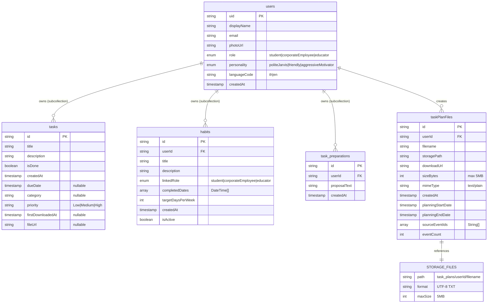

# Data Model / ER Diagram

This ER diagram maps Yhar Bid's data architecture across Firestore and Firebase Storage. The users collection serves as the root entity with three subcollections (tasks, habits, task_preparations). The taskPlanFiles collection exists at the top level and links to users via userId. Firebase Storage holds the actual TXT files referenced by taskPlanFiles metadata. Key relationships: users (1) → tasks (N), users (1) → habits (N), users (1) → taskPlanFiles (N), taskPlanFiles (1) → Storage files (1). The habits collection links back to user roles via the linkedRole enum field. Task plan files reference calendar events through sourceEventIds arrays.

## Diagram

## Entities

- users
- tasks
- habits
- task_preparations
- taskPlanFiles
- STORAGE_FILES

## Coverage

- Firestore collections: users (with 3 subcollections), taskPlanFiles (top-level)
- Firebase Storage: task_plans/{userId}/{filename}
- Relationships: 1:N from users to subcollections, 1:N from users to taskPlanFiles, 1:1 from taskPlanFiles to storage files
- Keys: uid (users PK), userId (FK in habits/taskPlanFiles), id (PK in tasks/habits/taskPlanFiles)
- Cardinality: ||--o{ (one-to-many), ||--|| (one-to-one)
