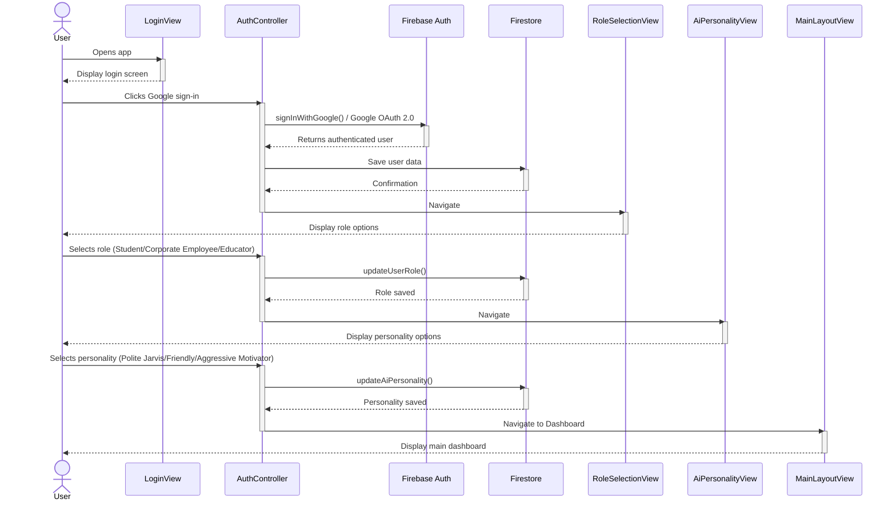
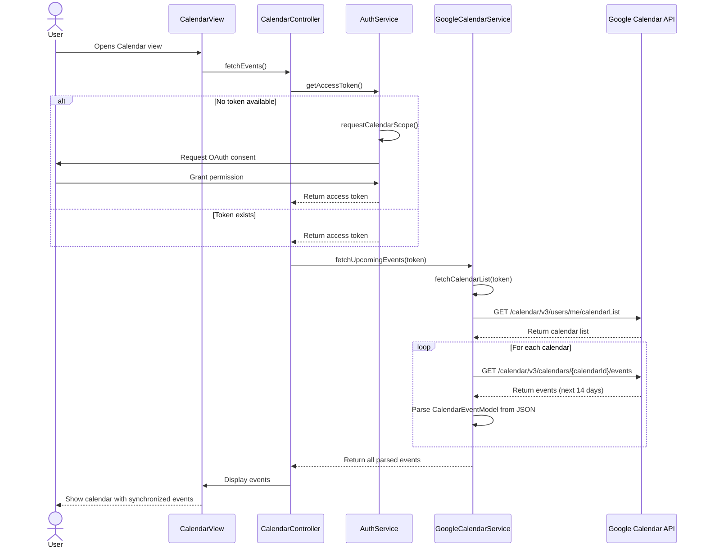
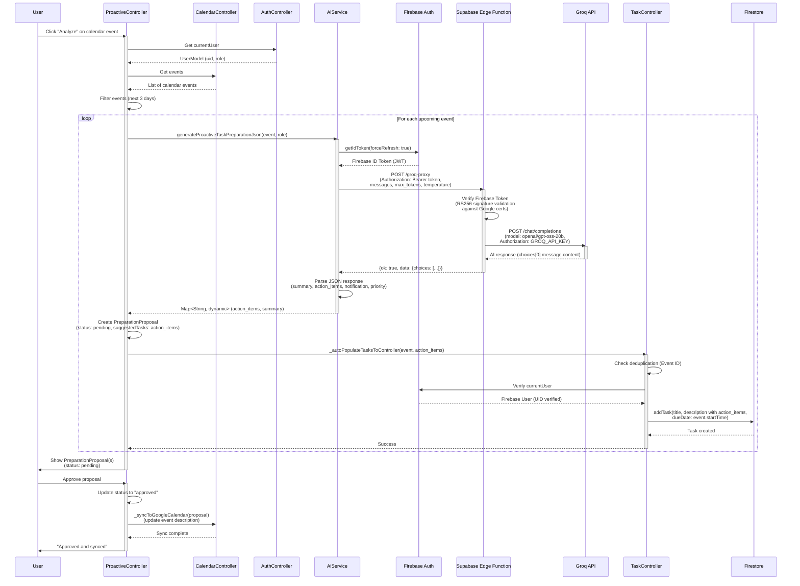

# Sequence Diagrams

This document contains sequence diagrams for the key functional requirements.

## Diagram 1

This sequence diagram illustrates the complete user onboarding flow from initial app launch through Google OAuth authentication, role selection, AI personality customization, and final navigation to the main dashboard. The flow captures all key interactions between the user and the system components, including data persistence to Firestore at critical checkpoints.

### Sequence Diagram

### Components

- User
- LoginView
- AuthController
- Firebase Auth
- Firestore
- RoleSelectionView
- AiPersonalityView
- MainLayoutView

### FR Coverage

- FR-1: Role-Based Onboarding & Style Selection
- Google OAuth 2.0 authentication
- Role selection (Student/Corporate Employee/Educator)
- AI personality selection (Polite Jarvis/Friendly/Aggressive Motivator)
- User data persistence to Firestore
- Navigation flow from login to dashboard

---

## Diagram 2

This sequence diagram illustrates the Google Calendar synchronization flow in FR-2. The process begins when a user opens the Calendar view, triggering an event fetch. The system first checks for an access token through the AuthService. If no token exists, it initiates the OAuth consent flow where the user grants calendar permissions. Once authenticated, the CalendarController requests upcoming events from the GoogleCalendarService, which first fetches all available calendars, then iterates through each calendar to retrieve events for the next 14 days via the Google Calendar API. The retrieved JSON data is parsed into CalendarEventModel objects and displayed in the CalendarView. This design ensures proper authentication before API access and handles multiple calendar sources in a single synchronization session.

### Sequence Diagram

### Components

- User
- CalendarView
- CalendarController
- AuthService
- GoogleCalendarService
- Google Calendar API

### FR Coverage

- User authentication flow
- OAuth consent for calendar scope
- Token retrieval and validation
- Fetching calendar list
- Iterating through multiple calendars
- Retrieving events for next 14 days
- Parsing JSON to CalendarEventModel
- Displaying events in UI

---

## Diagram 3

This Mermaid sequence diagram illustrates FR-3: Proactive Role-Based Task Preparation workflow as implemented in ProactiveController.

The flow starts when a user clicks "Analyze" on a calendar event, triggering ProactiveController.runProactiveScan(). The controller retrieves upcoming events from CalendarController (filtered for the next 3 days), then iterates through each event to generate AI-powered task preparation proposals.

For each event, AiService.generateProactiveTaskPreparationJson() is called, which:
1. Retrieves a Firebase ID token from Firebase Auth (getIdToken with force refresh)
2. Sends a POST request to the Supabase Edge Function at /groq-proxy
3. The Edge Function verifies the Firebase token using RS256 signature validation against Google's public certificates
4. After successful verification, the Edge Function forwards the request to Groq API using the server-side GROQ_API_KEY
5. Groq API processes the request with model "openai/gpt-oss-20b" and returns AI-generated preparation content
6. The response flows back through the Edge Function to AiService

The AI response (containing summary, action_items, notification, priority) is wrapped into a PreparationProposal object with status "pending" and shown to the user for review.

Critically, the system automatically populates tasks to the TaskController via _autoPopulateTasksToController(), which creates ONE consolidated task per event (with deduplication checks) and saves it to Firestore. This happens during the scan, not during approval.

When the user approves a proposal, ProactiveController.approveProposal() updates the proposal status and syncs the preparation outline back to Google Calendar by updating the event description.

Note: The task description mentions TaskPlanTxtService and Firebase Storage, but these are part of a separate workflow (TaskPlanFileController.generateTaskPlanFromCalendar) that is NOT called by ProactiveController. The actual FR-3 implementation focuses on real-time proposal generation and task auto-population, not document file generation.

### Sequence Diagram

### Components

- User
- ProactiveController
- CalendarController
- AuthController
- AiService
- Firebase Auth
- Supabase Edge Function
- Groq API
- TaskController
- Firestore

### FR Coverage

- FR-3.1: Proactive calendar scanning (3-day window)
- FR-3.2: Role-based AI task preparation
- FR-3.3: User approval workflow
- FR-3.4: Auto-population to task tracker
- FR-3.5: Two-way calendar sync (write back)
- NFR-6: Firebase token verification (RS256)
- NFR-6: Groq API proxy architecture

---

