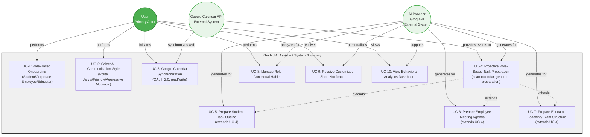

# Use Case Diagram

This Mermaid use case diagram covers all SRS requirements for Yhar Bid (Yharbid). The system boundary encompasses the Yharbid AI Assistant application. Three actors interact with the system: User (primary), Google Calendar API (external integration for calendar synchronization), and AI Provider (external Groq API for AI-powered features). The diagram shows 10 use cases aligned with the 6 functional requirements from the SRS. UC-1 and UC-2 handle onboarding and AI style selection (FR-1). UC-3 provides two-way Google Calendar synchronization (FR-2). UC-4 is the core proactive preparation flow (FR-3), with UC-5, UC-6, and UC-7 as role-specific extensions for Student, Corporate Employee, and Educator respectively. UC-8 manages role-contextual habits (FR-4). UC-9 delivers customized short notifications (FR-5). UC-10 provides the behavioral analytics dashboard (FR-6). The AI Provider participates in UC-4 through UC-9, supporting preparation generation, behavior analysis, and personalized messaging. Google Calendar API participates in UC-3 for bidirectional synchronization and UC-4 for event detection.

## Diagram

## Components

- User (primary actor)
- Google Calendar API (external system)
- AI Provider / Groq API (external system)
- Yharbid AI Assistant system boundary
- 10 use cases covering all 6 functional requirements
- Extension relationships (UC-5, UC-6, UC-7 extend UC-4)
- Actor-to-use-case relationships

## FR Coverage

- FR-1: Role-Based Onboarding & Style Selection (UC-1, UC-2)
- FR-2: Google Calendar Synchronization (UC-3)
- FR-3: Proactive Role-Based Task Preparation (UC-4, UC-5, UC-6, UC-7)
- FR-4: Role-Contextual Habit Tracker (UC-8)
- FR-5: Customized Short Notifications (UC-9)
- FR-6: Behavioral Analytics Dashboard (UC-10)
